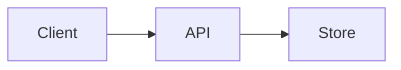

# Vision: <product>

Copy this file to `docs/vision.md` on a new-product repo. Fill every
section. Use LOCKED or UNKNOWN. Skill: `visionary`.

## Objective

One sentence. What is true when this product has won.

LOCKED / UNKNOWN:

## Success

| id | metric | target | how measured | fail-when |
|----|--------|--------|--------------|-----------|
| S1 | | | | |

At least one row, or this whole table is UNKNOWN.

## Shape

Primary (one): service | website | app

Hybrid note (which surface is the product):

LOCKED / UNKNOWN:

## Stack

Default:

Why:

Why-not:

LOCKED / UNKNOWN:

## Architecture

Who talks to what. Process / data / trust boundaries. Phase 0 only.

Mermaid rules (human scale): one diagram per concern; about 5-9 nodes
each (hard ceiling 12 - split if larger); one-sentence caption on the
line above every mermaid fenced block; optional tiny index diagram of
diagram names only; prefer sequenceDiagram / stateDiagram-v2 /
flowchart by concern; same component names across diagrams; no
horizontal scroll at normal GitHub width.

Caption: what this flow shows and why it matters.

LOCKED / UNKNOWN:

## Screens

HTML mocks in `docs/mocks/` (kebab-case). Key screens plus empty and
error. No PNGs. Visual UAT later: `design-uat`.

| id | file | state |
|----|------|-------|
| M1 | docs/mocks/home.html | primary |
| M2 | docs/mocks/empty.html | empty |
| M3 | docs/mocks/error.html | error |

## LOCKED

- 

## UNKNOWN

- 
