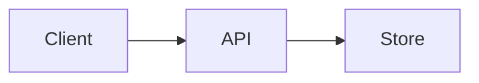

# Vision: mermaid no caption

## Objective

One sentence win.

LOCKED

## Success

| id | metric | target | how measured | fail-when |
|----|--------|--------|--------------|-----------|
| S1 | pack validates | exit 0 | `python tools/validate-vision-pack.py` | non-zero |

LOCKED

## Shape

Primary: service

LOCKED

## Stack

Default: Python tools.

LOCKED

## Architecture

LOCKED
